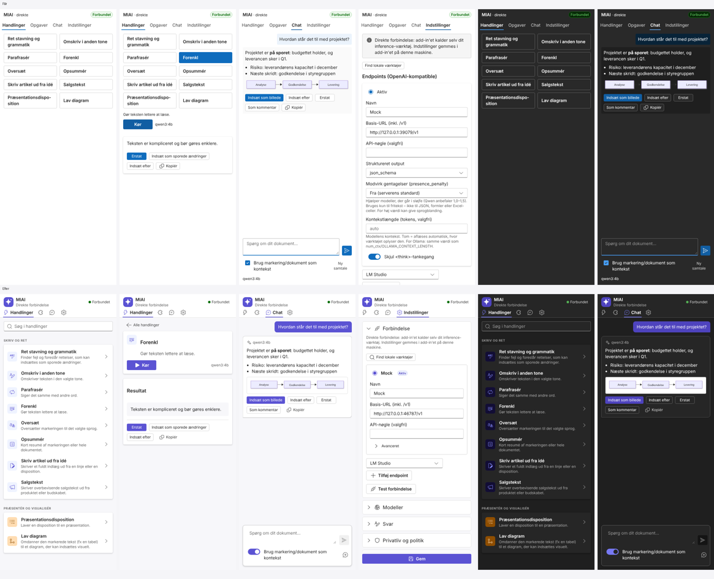

# MIAI's brugerflade – designsystem

Gælder task pane i Word, Excel og PowerPoint (#17). Al styling sker med Fluent UI v9-tokens og konstanterne i [`packages/addin/src/theme.ts`](../../packages/addin/src/theme.ts). Komponenterne må ikke have hårdkodede farver eller pixelværdier, hvilket ESLint håndhæver.



Flere skærmbilleder i [`foer/`](foer) og [`efter/`](efter).

## Principper
- **Rolig og indholdsfokuseret.** Indhold ligger i kort på en let tonet baggrund. Brandfarven bruges sparsomt: primær handling, valgt fane og fokus.
- **Følger Office.** Lyst og mørkt tema følger Office' tema, også når brugeren skifter undervejs (`OfficeThemeChanged`). Office' standardfont (Segoe UI) bruges.
- **Smalt først.** Layoutet skal holde fra 320 px. Under 480 px viser fanerne kun ikon, undtagen den valgte. Der må ikke være vandret scroll, hvilket testes.
- **Tilgængeligt.** WCAG 2.1 AA: kontrast, tastaturnavigation, synligt fokus og navngivne knapper. axe kører på alle hovedvisninger i begge temaer.
- **Diskret bevægelse.** Kort indtoning (160 ms), som slås fra ved `prefers-reduced-motion`.

## Brandpalet
En indigo-violet rampe genereret i OKLCH med visuelt jævne trin. Den adskiller sig fra Words blå, Excels grønne og PowerPoints orange, så MIAI har sin egen identitet uden at støde mod værtsappen.

| Trin | Farve |
|---|---|
| 10 | `#080717` |
| 20 | `#120D35` |
| 30 | `#1D1452` |
| 40 | `#291C6F` |
| 50 | `#35278B` |
| 60 | `#4134A6` |
| 70 | `#4E43BE` |
| 80 | `#5B53D3` |
| 90 | `#6966E5` |
| 100 | `#7779F3` |
| 110 | `#878DFE` |
| 120 | `#99A2FF` |
| 130 | `#ACB6FF` |
| 140 | `#C7CDF1` |
| 150 | `#DCE0F5` |
| 160 | `#EFF3FF` |

**Brug:**

| Element | Lyst tema | Mørkt tema |
|---|---|---|
| Primær knap | trin 80 | trin 70 |
| Brandfarvet tekst og links | trin 80 | trin 110 |
| Kategori "Skriv og ret" | trin 160 som baggrund | trin 20 som baggrund |

I mørkt tema bruges trin 110 til tekst, fordi trin 100 kun giver ca. 4:1 mod baggrunden.

**Kategorier** (ikonfelter foran handlinger), afledt af Fluents palet:

| Kategori | Farve |
|---|---|
| Skriv og ret | Brand |
| Præsentér og visualisér | Peach |
| Beregn og analysér | Teal |
| Egne opgaver | Lavender |

**Status:** grøn (forbundet), mørk orange (ingen model), rød (bridgen svarer ikke).

## Kontrast (målt)
Kontrasten måles automatisk i [`theme.test.ts`](../../packages/addin/src/theme.test.ts). Kravene er 4,5:1 for tekst og 3:1 for ikoner og andre grafiske elementer.

| Tema | Element | Farver | Kontrast | Krav |
|---|---|---|---|---|
| Lyst | Brødtekst på kort | `#242424` på `#ffffff` | 15,52:1 | 4,5:1 |
| Lyst | Dæmpet tekst på kort | `#616161` på `#ffffff` | 6,19:1 | 4,5:1 |
| Lyst | Tekst på primær knap | `#ffffff` på `#5B53D3` | 5,80:1 | 4,5:1 |
| Lyst | Brandfarvet tekst / link | `#5B53D3` på `#ffffff` | 5,80:1 | 4,5:1 |
| Lyst | Ikon, kategori Skriv | `#5B53D3` på `#EFF3FF` | 5,23:1 | 3:1 |
| Lyst | Ikon, kategori Præsentér | `#8f4e00` på `#ffddb3` | 4,99:1 | 3:1 |
| Lyst | Ikon, kategori Analysér | `#02494c` på `#9bd9db` | 6,48:1 | 3:1 |
| Lyst | Ikon, egne opgaver | `#3f3682` på `#d2ccf8` | 6,66:1 | 3:1 |
| Lyst | Status: forbundet | `#0e700e` på `#ffffff` | 6,28:1 | 3:1 |
| Lyst | Status: advarsel | `#c43501` på `#ffffff` | 5,44:1 | 3:1 |
| Lyst | Status: fejl | `#bc2f32` på `#ffffff` | 5,85:1 | 3:1 |
| Lyst | Fokusramme | `#000000` på `#ffffff` | 21,00:1 | 3:1 |
| Mørkt | Brødtekst på kort | `#ffffff` på `#262626` | 15,13:1 | 4,5:1 |
| Mørkt | Dæmpet tekst på kort | `#adadad` på `#262626` | 6,74:1 | 4,5:1 |
| Mørkt | Tekst på primær knap | `#ffffff` på `#4E43BE` | 7,32:1 | 4,5:1 |
| Mørkt | Brandfarvet tekst / link | `#878DFE` på `#262626` | 5,24:1 | 4,5:1 |
| Mørkt | Ikon, kategori Skriv | `#878DFE` på `#120D35` | 6,41:1 | 3:1 |
| Mørkt | Ikon, kategori Præsentér | `#ffddb3` på `#8f4e00` | 4,99:1 | 3:1 |
| Mørkt | Ikon, kategori Analysér | `#9bd9db` på `#02494c` | 6,48:1 | 3:1 |
| Mørkt | Ikon, egne opgaver | `#d2ccf8` på `#3f3682` | 6,66:1 | 3:1 |
| Mørkt | Status: forbundet | `#54b054` på `#262626` | 5,56:1 | 3:1 |
| Mørkt | Status: advarsel | `#e9835e` på `#262626` | 5,67:1 | 3:1 |
| Mørkt | Status: fejl | `#e37d80` på `#262626` | 5,41:1 | 3:1 |
| Mørkt | Fokusramme | `#ffffff` på `#262626` | 15,13:1 | 3:1 |

## Struktur
- **Header:** mærke, tilstand (direkte/bridge) og status. Statusmærket kan klikkes og åbner Indstillinger, når der ikke er forbindelse.
- **Handlinger:** handlingerne står i en liste grupperet i kategorier, med ikon, navn og beskrivelse. Søgning vises ved mere end 8 handlinger. En valgt handling åbner sit eget trin: parametre → **Kør** → resultat → indsæt.
- **Egne opgaver:** liste med ikonknapper (rediger, eksportér, slet) og en tom tilstand med næste skridt.
- **Chat:** bobler, tom tilstand med forslag pr. værtsapp, skelet mens svaret kommer, og inputfeltet fast nederst.
- **Indstillinger:** sektioner (Forbindelse, Modeller, Svar, Privatliv og politik, Generelt). Sjældne endpoint-indstillinger ligger under *Avanceret*, og gem-knappen sidder fast nederst.
- **Figurer** (Mermaid/SVG) står altid på hvidt "papir", så de kan læses i mørkt tema.

## Tests
- `theme.test.ts`: kontrast for paletten.
- `e2e/a11y.spec.ts`: axe på hovedvisningerne i begge temaer, live temaskift, og ingen vandret scroll ved 320 og 450 px.
- `e2e/visual.spec.ts`: skærmbillede-sammenligning af hovedvisningerne i lyst og mørkt tema. Testene bruger en fast skrifttype (Inter), men kantudglatning afhænger stadig af maskinen, så referencebillederne er dem, CI's Linux-runner laver.

  Efter en bevidst designændring opdateres referencebillederne i CI: Actions → **Visuelle baselines** → *Run workflow*, eller:
  ```bash
  gh workflow run visual-baselines.yml
  ```
  Workflowet committer de nye billeder til main. Lokalt kan de genereres med `npx -w @miai/addin playwright test -c e2e/playwright.config.ts visual --update-snapshots` til egen sammenligning, men de bør ikke committes.
- Dokumentationsbillederne i `efter/` laves med:
  ```bash
  MIAI_SCREENSHOTS=$PWD/docs/ui/efter npx -w @miai/addin playwright test -c e2e/playwright.config.ts screenshots
  ```
